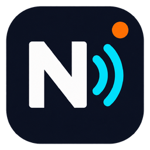
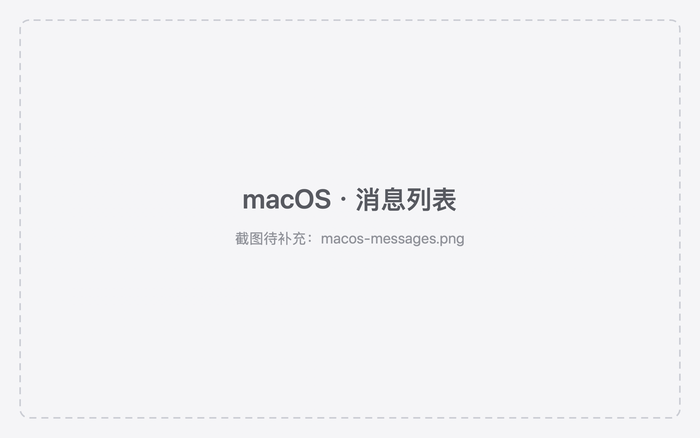
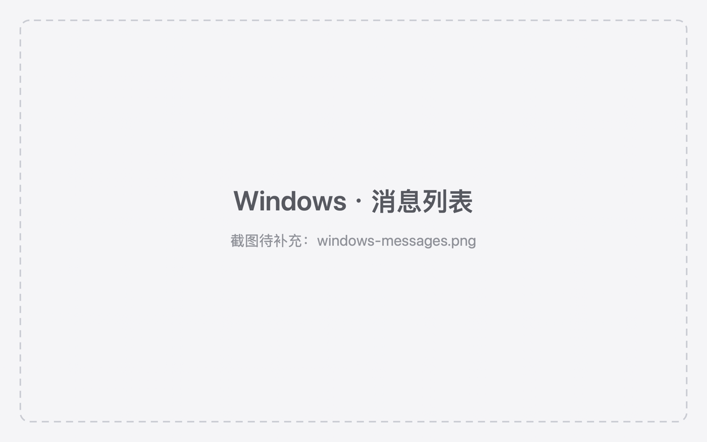
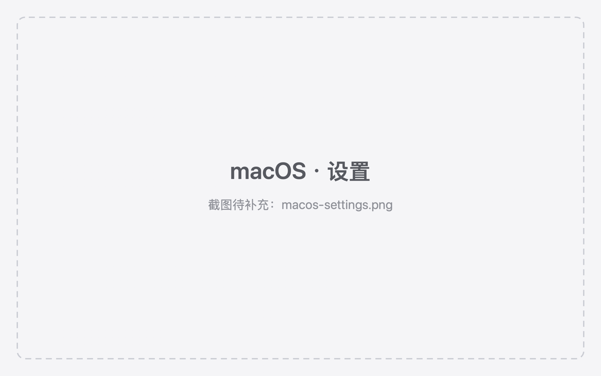
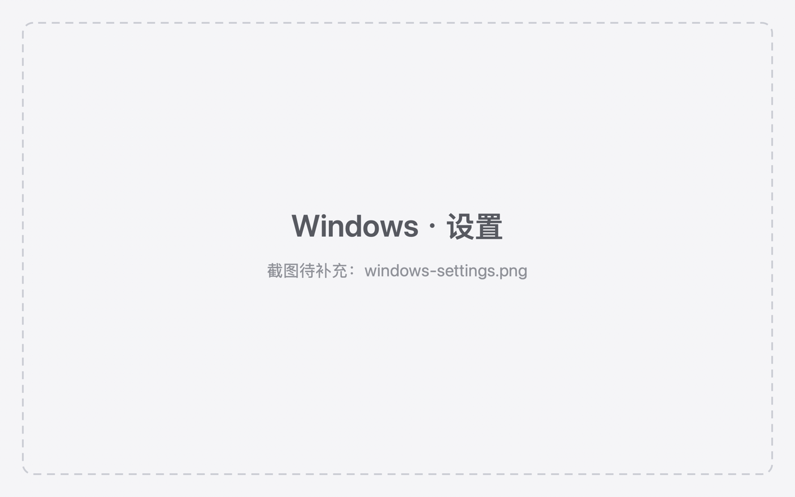

<div align="center">



# Nexthrum

**面向 Windows 与 macOS 的 Gotify 桌面客户端 —— 一套 Rust 内核，两个原生前端。**

<a title="English" href="./README.md"></a> 

[](https://github.com/sseaan/Nexthrum/releases)
[](./LICENSE)
[](https://github.com/sseaan/Nexthrum/actions/workflows/ci.yml)
[](https://github.com/sseaan/Nexthrum/actions/workflows/build.yml)
<br>


[](https://github.com/sseaan/Nexthrum/commits/main)

</div>

> 自建 [Gotify](https://gotify.net/) 服务器的桌面客户端：消息经 WebSocket 实时到达，写入本地 SQLite 历史，并以系统原生通知、托盘 / 菜单栏未读标记呈现 —— 无遥测，不依赖任何第三方服务。

Nexthrum 刻意做了两套前端：Windows 用 Tauri 2 + React，macOS 用 SwiftUI，但两者调用**同一批 Rust crate** 处理消息规则、存储与 Gotify 协议。消息规则改一次，两端同时生效。

**适合你，如果你想要：**
- 在桌面上阅读、搜索 Gotify 历史，而不是一直开网页
- 支持真实免打扰时段的系统原生通知
- 把客户端令牌放进系统凭据库，而不是配置文件
- 一个只跟你自己服务器通信、代码可审计的小客户端

**可能不适合你，如果你需要：**
- 手机端（目前没有）
- 托管服务或多账号切换
- 除 Gotify 之外的通用通知中心

<div align="center">

### 界面截图

<table>
  <tr>
    <td align="center" width="50%"><br><sub>macOS · 消息列表</sub></td>
    <td align="center" width="50%"><br><sub>Windows · 消息列表</sub></td>
  </tr>
  <tr>
    <td align="center"><br><sub>macOS · 设置</sub></td>
    <td align="center"><br><sub>Windows · 设置</sub></td>
  </tr>
</table>

</div>

---

<details>
<summary><strong>目录</strong></summary>

- [功能特性](#功能特性)
- [安装](#安装)
- [快速开始](#快速开始)
- [从源码构建](#从源码构建)
- [架构](#架构)
- [数据与隐私](#数据与隐私)
- [文档](#文档)
- [版本历史](#版本历史)
- [许可](#许可)

</details>

---

## 功能特性

<details open>
<summary><strong>消息</strong></summary>

- **实时消息流** — Gotify WebSocket 客户端支持自动重连与退避、停止即取消、10 秒握手超时，界面不会一直卡在「正在连接」。
- **本地历史** — SQLite 存储，保留天数可配置（1–365 天，默认 7 天）。重复投递保留本地已读状态，且不会重复通知。
- **扁平可读的列表** — 用细分割线分隔消息行，而不是层层嵌套的卡片；未读状态用三种冗余线索表达（圆点、字重、强调色时间），并带来源与优先级徽标。
- **搜索** — 对标题与正文做防抖、不区分大小写的匹配；搜索期间未读数仍为全局值。
- **来源筛选** — 消息来自两个以上 Gotify 应用时自动出现；名称取自 `/application`，取不到时回退为 `App <id>`。
</details>

<details>
<summary><strong>桌面集成</strong></summary>

- **系统原生通知** — Windows toast 通知与 macOS `UserNotifications`，都受内核统一的免打扰时段约束。
- **常驻入口** — Windows 托盘带未读红点与 tooltip；macOS 菜单栏面板显示最近三条消息并提供快捷操作。
- **符合平台习惯的窗口** — Windows 使用自绘标题栏（Logo、产品名、最小化 / 最大化 / 关闭、双击最大化）；macOS 保留原生工具栏，并可隐藏程序坞图标、只留菜单栏。
- **开机启动** — Windows 自启动项与 macOS `SMAppService`，并在设置中显示系统真实审批状态。
</details>

<details>
<summary><strong>外观、安全与更新</strong></summary>

- **深色与白天** — 一套语义化 Token 支撑两种主题；Windows 在设置中可选「跟随系统 / 白天 / 深色」，macOS 跟随系统外观。
- **界面本地化** — 支持简体中文与英文；Windows 可在设置中切换，macOS 跟随系统语言（可在设置中切换，重启后生效）。
- **安全的凭据存储** — 客户端令牌不写入设置 JSON：Windows 用凭据管理器，macOS 用钥匙串，并支持旧明文令牌的幂等迁移。
- **签名更新** — Windows 使用 `tauri-plugin-updater` 与 minisign 签名的 `latest.json`；macOS 使用 Sparkle 与 EdDSA 签名的 `appcast.xml`。两端都能在设置页看到更新入口，macOS 还提供「自动检查更新」开关。
</details>

---

## 安装

从 [GitHub Releases](https://github.com/sseaan/Nexthrum/releases) 下载最新版本。

### Windows

| 文件 | 说明 |
|---|---|
| `Nexthrum_2.0.1_x64-setup.exe` | NSIS 安装包（当前用户安装，无需管理员） |
| `Nexthrum_2.0.1_x64-portable.zip` | 便携版，解压即用 |

安装包**未做** Authenticode 签名，首次运行会出现 SmartScreen「Windows 已保护你的电脑」提示：选择「更多信息 → 仍要运行」。

### macOS

| 文件 | 说明 |
|---|---|
| `Nexthrum-2.0.1-arm64.dmg` | 拖拽安装包（Apple Silicon，macOS 14+） |
| `Nexthrum-2.0.1.zip` | 供 Sparkle 自动更新使用的应用包 |

应用**未做公证**（没有付费 Apple Developer 账号），首次打开需要右键 → 打开，或执行：

```bash
xattr -dr com.apple.quarantine /Applications/Nexthrum.app
```

由 Sparkle 安装的更新不带隔离标记，后续升级不会再提示。

---

## 快速开始

1. 启动 Nexthrum —— 窗口打开，同时出现托盘图标 / 菜单栏图标。
2. 打开**设置**，填入 **Gotify 服务器地址**（例如 `https://gotify.example.com`）与**客户端令牌**（Gotify 网页端 → *Clients*）。
3. 点击**测试连接**，再**保存** —— WebSocket 会自动开始工作。
4. 从 Gotify 发一条消息：它会出现在列表里，并在非免打扰时段弹出系统通知。

点击消息行会把正文复制到剪贴板并标记已读；右键可「标记为已读」或「删除」。

---

## 从源码构建

### 环境要求

| 平台 | 要求 |
|---|---|
| Windows | Node.js 20+、Rust stable（MSVC 工具链）、Visual Studio C++ Build Tools、WebView2 |
| macOS | Node.js 20+、Rust stable、Xcode 26+（arm64） |
| 通用 | Git，`cargo` 与 `npm` 在 `PATH` 中 |

### Windows 客户端

```bash
git clone https://github.com/sseaan/Nexthrum.git
cd Nexthrum

npm --prefix apps/windows ci
npm --prefix apps/windows run tauri dev     # 开发模式，支持热更新
npm --prefix apps/windows run tauri build   # NSIS 安装包 + 更新产物
```

开发服务器需要与 `build.devUrl` 一致的固定端口；Windows 上 Hyper-V 会保留端口段，若 Vite 报端口被占用，执行 `powershell -ExecutionPolicy Bypass -File scripts/dev-port.ps1` 自动挑选可用端口。

### macOS 客户端

```bash
scripts/generate-swift-bindings.sh          # 生成 Swift 用的 UniFFI bindings
scripts/build-macos-xcode.sh                # 构建并校验 Nexthrum.app
scripts/package-macos-dmg.sh                # 本地分发用的签名 DMG

# 单元测试
DEVELOPER_DIR=/Applications/Xcode.app/Contents/Developer xcodebuild \
  -project apps/macos/Nexthrum.xcodeproj -scheme Nexthrum \
  -destination 'platform=macOS,arch=arm64' CODE_SIGNING_ALLOWED=NO test
```

macOS 构建使用 `scripts/create-local-signing-identity.sh` 创建的**稳定自签身份**，保证多次重建后代码签名（以及钥匙串授权）保持一致；它不能替代公证。

> 必须使用较新的 SDK 构建。用旧 SDK 链接出来的 app 在 macOS 26/27 上会退回旧界面设计，看起来和其他原生应用不一致。发布构建在 `macos-26` runner 上完成，可用产物 `Info.plist` 里的 `DTSDKName` 校验。

### 检查项

```bash
cargo fmt --all --check
cargo test --workspace
cargo clippy --workspace --all-targets -- -D warnings
npm --prefix apps/windows run typecheck
npm --prefix apps/windows test
npm --prefix apps/windows run build
npm --prefix apps/windows run check:tauri-versions
```

CI（`.github/workflows/ci.yml`）在 Windows 与 macOS arm64 上跑同一组门槛，另外还包括 UniFFI 生成、Xcode 构建与 XCTest。

---

## 架构

```
apps/windows (React)  ──Tauri──┐
                               ├── nexthrum-core ── nexthrum-storage (SQLite)
apps/macos (SwiftUI) ──UniFFI──┘        │            nexthrum-gotify (HTTP/WS)
                                        └── 宿主适配层：托盘、通知、凭据、
                                            窗口生命周期、更新
```

- `nexthrum-core` 负责全部业务规则：消息入库、去重、已读状态、免打扰、保留策略。它不依赖 UI、Tauri 或平台路径。
- `nexthrum-gotify` 负责 HTTP API 与 WebSocket 客户端，包含重连退避、取消、类型化错误与 rustls crypto provider 初始化。
- `nexthrum-storage` 负责 SQLite 迁移、查询与设置读写，路径由宿主注入。
- `nexthrum-ffi` 为 Swift 提供稳定的 UniFFI 接口（`BridgeService`、DTO、类型化错误）。
- 宿主适配层保持轻量：Tauri command 与 SwiftUI bridge 只做输入校验、调用内核用例、转发事件。

状态以内核为准：未读数与消息列表始终来自原子快照，mutation 命令直接返回变更后的快照。

### 仓库结构

```
apps/
  windows/            Windows 客户端（React + Vite）与 Tauri 宿主
  macos/              SwiftUI 应用、Xcode 工程、XCTest、Sparkle（Vendor/）
crates/
  nexthrum-core/      领域模型、用例、免打扰与通知策略
  nexthrum-gotify/    Gotify HTTP/WebSocket 客户端
  nexthrum-storage/   SQLite 仓储、迁移、设置
  nexthrum-ffi/       UniFFI bridge
scripts/              bindings、图标、macOS 构建/打包、签名身份、开发端口
tools/uniffi-bindgen/ 本地 Swift bindings 生成器
docs/                 需求、架构、设计、技术规范、发布手册
devlog/               每日开发日志
```

### 技术栈

| 层 | Windows | macOS |
|---|---|---|
| 界面 | React 18 + TypeScript + Tailwind CSS v4 + Zustand | SwiftUI |
| 宿主 | Tauri 2（Rust） | AppKit bridge + UniFFI |
| 内核 | Rust workspace（`nexthrum-core`、`nexthrum-gotify`、`nexthrum-storage`） | 同一批 crate |
| 存储 | SQLite（rusqlite） | 同一套仓储 |
| 实时流 | tokio-tungstenite + rustls | 同一个客户端 |
| 通知 | `tauri-plugin-notification` | `UserNotifications` |
| 更新 | `tauri-plugin-updater`（`latest.json`） | Sparkle（`appcast.xml`） |
| 凭据 | Windows 凭据管理器 | 钥匙串 |

---

## 数据与隐私

- Nexthrum 只与你配置的 Gotify 服务器通信；没有遥测，也不经过任何第三方服务。
- 令牌保存在平台凭据库中，绝不写入 `settings.json`；日志会脱敏。
- 本地数据位置：
  - Windows：`%APPDATA%\Nexthrum\nexthrum_messages.db` 与 `nexthrum_data\settings.json`
  - macOS：`~/Library/Application Support/Nexthrum/`
- 除非在清空对话框中勾选「同时删除服务器上的消息」，本地删除不会影响服务器。

---

## 文档

| 文档 | 内容 |
|---|---|
| [`docs/requirements.md`](docs/requirements.md) | 需求与验收标准 |
| [`docs/architecture.md`](docs/architecture.md) | 模块职责、事件、持久化、更新通道 |
| [`docs/tech-spec.md`](docs/tech-spec.md) | 分层规则、依赖、质量门槛 |
| [`docs/design-spec.md`](docs/design-spec.md) | 视觉规范、布局、可访问性 |
| [`docs/release.md`](docs/release.md) | 版本号来源、签名、更新、测试版、检查清单 |
| [`docs/development-guide.md`](docs/development-guide.md) | 环境搭建与开发流程 |
| [`docs/windows-testing.md`](docs/windows-testing.md) | Windows 真机测试清单 |
| [`docs/history.md`](docs/history.md) | 版本历史与已归档的规划记录 |
| [`AGENTS.md`](AGENTS.md) | 面向自动化助手的工作约定 |

---

## 版本历史

| 版本 | 日期 | 亮点 |
|---|---|---|
| **2.0.1** | 2026-10-24 | Windows 界面重做（竖版窗口、类 macOS 扁平视觉、主题切换按钮、更清晰的行内层级）；macOS 新增隐藏程序坞图标与语言切换、设置页更新入口；依赖与发布工具链修复 |
| 2.0.0 | 2026-10-23 | 首个跨平台版本，共用 Rust 内核：卡片列表、搜索、来源筛选、托盘未读红点、菜单栏面板、凭据入系统凭据库、双平台自动更新 |
| 1.0.1 | 2026-07-02 | 仅 Windows 的维护版本 |
| 1.0.0 | 2026-07-02 | 仅 Windows 的首个版本 |

更详细的记录与已归档的规划文档见 [`docs/history.md`](docs/history.md)。

---

## 许可

Copyright © 2026 Sean.

Nexthrum 是以 **GNU Affero 通用公共许可证 v3.0**（AGPL-3.0）发布的自由软件，完整条款见 [LICENSE](LICENSE)。

你可以依据该许可证使用、研究、修改与再分发。由于 AGPL-3.0 同样约束通过网络提供的软件，如果你把修改后的 Nexthrum 作为网络服务提供，需要向使用者提供对应源码。许可证不提供任何担保。
